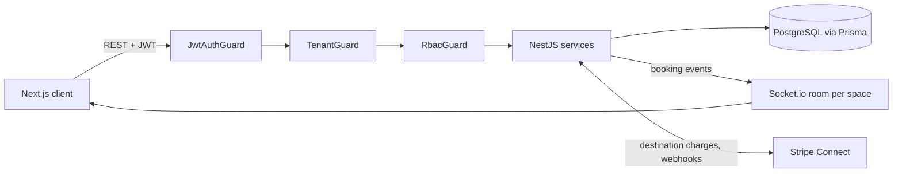

# Multi-Tenant Coworking Management SaaS


A B2B web platform that lets independent coworking operators run their space on one shared application, while each space's data stays isolated from every other space. Members see a live floor plan, book desks and rooms, and pay online. Managers configure their space, pricing and payouts. A platform administrator oversees every space.

Built as a team capstone project at Chitkara University.


---

## Table of Contents

- [Why this project](#why-this-project)
- [Features](#features)
- [Roles](#roles)
- [Tech stack](#tech-stack)
- [Architecture](#architecture)
- [Key design decisions](#key-design-decisions)
- [Project structure](#project-structure)
- [Getting started](#getting-started)
- [API overview](#api-overview)
- [Screenshots](#screenshots)
- [Known limitations and roadmap](#known-limitations-and-roadmap)
- [Team](#team)
- [License](#license)

---

## Why this project

Many independent coworking spaces still run on spreadsheets, chat threads and manual bank transfers. That leads to three recurring problems: desks and rooms get double-booked, there is no single source of truth for who has paid, and neither operators nor members can see availability in real time.

This platform addresses all three with one multi-tenant application: every space is a tenant, all tenants share one app and one database, and the hard guarantees (isolation, no double-booking, correct payment splits) are enforced on the server, not in the UI.

## Features

- **Multi-tenant isolation**: the space ID comes from the JWT and is re-verified on every request. Cross-tenant access returns `404`, not `403`, so resource existence is never leaked.
- **Role-based access control**: Platform Administrator, Space Manager and Member.
- **Double-booking prevention**: a PostgreSQL exclusion constraint (`EXCLUDE USING gist`) decides conflicts atomically. The API maps the violation to `409 Conflict`.
- **Real-time floor plan**: booking changes reach all connected clients through Socket.io, with one room per space and a JWT-authenticated handshake.
- **Booking holds**: an unpaid booking reserves its slot for 15 minutes, then the slot is released.
- **Stripe Connect payments**: destination charges with an automatic 95/5 split between the space manager and the platform, plus payment retry and self-healing status reconciliation (test mode only).
- **Soft delete with cancel-and-refund**: spaces, zones, desks and rooms are never hard-deleted. Deleting a resource with upcoming bookings cancels and refunds them after a two-step confirmation.
- **Analytics**: per-space revenue, utilization, 30-day trends and bookings per zone for managers, plus a platform-wide overview and per-space drill-down for administrators.
- **Public space directory**: members browse active spaces and join one.

## Roles

| Role | Scope | What they can do |
| --- | --- | --- |
| Platform Administrator | Cross-tenant | View platform-wide metrics, list every space, drill into any space's zones, members and paginated transactions. Seeded account only, no self-service signup. |
| Space Manager | Exactly one live space | Signup creates the space and the manager in one transaction. Manages zones, desks and rooms, sets hourly/daily prices, onboards to Stripe Connect, views analytics, and renames or soft-deletes resources. |
| Member | One space | Joins a space from the public directory, books desks and rooms, pays by card, views own bookings. |

## Tech stack

| Layer | Technologies |
| --- | --- |
| Frontend | Next.js 16 (App Router), React 19, Tailwind CSS 4, Zustand 5, socket.io-client, Stripe React SDK |
| Backend | NestJS 11, Prisma 7 (with the `pg` driver adapter), JWT, bcryptjs |
| Database | PostgreSQL 16 with the `btree_gist` extension |
| Real-time | Socket.io 4 |
| Payments | Stripe Connect (Accounts v2), Payment Element, webhooks |
| Testing and tooling | Jest, Vitest, Docker Compose |

## Architecture

Every request passes through three guards in a fixed order before reaching business logic:



Layers: Next.js client, NestJS controllers and services, Prisma, PostgreSQL. Real-time updates and payments branch off the business logic layer.

## Key design decisions

| Decision | Approach | Why |
| --- | --- | --- |
| Tenant isolation | Shared schema. `TenantGuard` reads the space ID from the JWT and each service re-checks ownership through the relation chain (for example `desk.zone.spaceId`). | Cheaper to run than database-per-tenant. Row-Level Security was considered and deferred for complexity. |
| Double-booking | Exclusion constraint on the booking time range, enforced by PostgreSQL. | Application-level "check then insert" is vulnerable to race conditions under concurrent requests. |
| Payments | Destination charges with a 5% platform fee. Card data is handled only by Stripe's Payment Element. | The backend never sees or stores raw card numbers. |
| Data lifecycle | Soft delete (`deletedAt`), `RESTRICT` foreign keys on User and Booking, stable `Booking.spaceId`. | Payment history and revenue reporting survive deletions. |
| Bookable items | `Booking` points to a Desk or Room via `bookableType` and `bookableId` without a foreign key. | A single foreign key cannot target two tables. Integrity is enforced in application code, a documented trade-off. |

## Project structure

```
.
├── apps/
│   ├── backend/        # NestJS API, Prisma schema, Socket.io gateway
│   └── frontend/       # Next.js app
├── docker-compose.yml  # Local PostgreSQL
├── package.json
└── LICENSE
```

<!-- VERIFY: confirm the folder names under apps/ and whether the root package.json defines workspaces or scripts. -->

## Getting started

### Prerequisites

- Node.js 20 or later and npm
- Docker Desktop (for the local PostgreSQL instance)
- A [Stripe](https://dashboard.stripe.com/register) account in **test mode**, with Connect enabled
- [Stripe CLI](https://docs.stripe.com/stripe-cli) (to forward webhooks locally)

### 1. Clone the repository

```bash
git clone https://github.com/SamyanSharma/Multi-Tenant-Coworking-Management-SaaS.git
cd Multi-Tenant-Coworking-Management-SaaS
```

### 2. Start PostgreSQL

```bash
docker compose up -d
```

### 3. Configure environment variables

Create a `.env` file in each app. Variable names below are the usual ones for this stack, so match them to your code.

<!-- VERIFY: replace with the exact variable names your apps read, then commit apps/backend/.env.example and apps/frontend/.env.example. -->

**`apps/backend/.env`**

```env
DATABASE_URL="postgresql://<user>:<password>@localhost:5432/<database>"
JWT_SECRET="<a-long-random-string>"
STRIPE_SECRET_KEY="sk_test_..."
STRIPE_WEBHOOK_SECRET="whsec_..."
FRONTEND_URL="http://localhost:3000"
```

**`apps/frontend/.env.local`**

```env
NEXT_PUBLIC_API_URL="http://localhost:<backend-port>"
NEXT_PUBLIC_STRIPE_PUBLISHABLE_KEY="pk_test_..."
```

### 4. Install dependencies

```bash
cd apps/backend && npm install
cd ../frontend && npm install
```

### 5. Set up the database

The booking exclusion constraint needs the `btree_gist` extension, which is enabled through the Prisma migrations.

```bash
cd apps/backend
npx prisma migrate dev
npx prisma db seed      # creates the seeded Platform Administrator account
```

<!-- VERIFY: confirm the seed command and document the seeded admin email here. -->

### 6. Run the app

In separate terminals:

```bash
# Backend
cd apps/backend
npm run start:dev

# Frontend
cd apps/frontend
npm run dev

# Stripe webhooks (needed to confirm payments locally)
stripe listen --forward-to localhost:<backend-port>/payments/webhook
```

Copy the `whsec_...` signing secret printed by the Stripe CLI into `STRIPE_WEBHOOK_SECRET`.

Open [http://localhost:3000](http://localhost:3000).

### Trying it out

1. Sign up as a **Space Manager**, which creates your space.
2. Add a zone, then desks or rooms with hourly and daily prices.
3. Complete Stripe Connect onboarding from the manager dashboard (test mode).
4. In another browser, sign up as a **Member** and join the space from the public directory.
5. Book a desk and pay with Stripe's test card `4242 4242 4242 4242`. Watch the floor plan update live in both browsers.

### Running tests

```bash
cd apps/backend && npm test
cd apps/frontend && npm test
```

## API overview

| Method | Endpoint | Access |
| --- | --- | --- |
| POST | `/auth/signup`, `/auth/login` | Public |
| GET | `/spaces/public` | Public |
| GET | `/spaces`, `/spaces/me`, `/spaces/:id` | Administrator or any authenticated role |
| POST | `/zones`, `/desks`, `/rooms` | Manager |
| GET | `/bookings` | Manager, Member |
| POST | `/bookings`, `/bookings/:id/pay` | Member |
| POST | `/payments/onboard` | Manager |
| GET | `/payments/status` | Manager |
| POST | `/payments/webhook` | Public, verified by Stripe signature |
| GET | `/analytics/summary`, `/analytics/bookings-per-zone` | Manager, Administrator |
| GET | `/admin/spaces/:id`, `/admin/spaces/:id/bookings`, `/admin/spaces/:id/members` | Administrator |

## Screenshots

<!-- Save images in docs/screenshots/ and replace these placeholders. -->

| Platform Admin OverviewSpace Manager Analytics | Member Browse Spaces |
| --- | --- |
|  |  |

| Space Manager Analytics | Space Manager Bookings |
| --- | --- |
|  |  |

## Known limitations and roadmap

This is a working prototype that runs locally. It is not yet deployed, and Stripe runs in test mode only.

**Planned next**

- [ ] Space closure and recreation (one live space per manager)
- [ ] Rate limiting and Helmet on login and signup
- [ ] Add `.env.example` files and fix the `start:prod` script
- [ ] Refresh end-to-end tests
- [ ] Trim the real-time booking payload for non-owning members
- [ ] Move hold expiry and Stripe reconciliation out of `GET /bookings` into a background job
- [ ] Choose a hosting environment and deploy

**Known trade-offs**

- JWTs are stored in `localStorage` (an `httpOnly` cookie would reduce XSS exposure) and there is no refresh-token or revocation mechanism.
- Tenant isolation is enforced in the application layer rather than with PostgreSQL Row-Level Security.
- Out of scope for this version: member-initiated cancellations, subscriptions, notifications, partial refunds, multiple currencies and Stripe live mode.

## Team

| Name | GitHub |
| --- | --- |
| Samyan Sharma | [@SamyanSharma](https://github.com/SamyanSharma) |
| Arpit Khanal | [@ArpitKhanal](https://github.com/ArpitKhanal) |
| Prakriti Shrestha | [@prakriti-stha9](https://github.com/prakriti-stha9) |
| Nitesh Kumar Sah | [@niteshsah45](https://github.com/niteshsah45) |

Project mentor: Mr. Baljeet Singh, Department of Computer Science and Engineering, Chitkara University.

## License

Distributed under the MIT License. See [`LICENSE`](LICENSE) for details.
